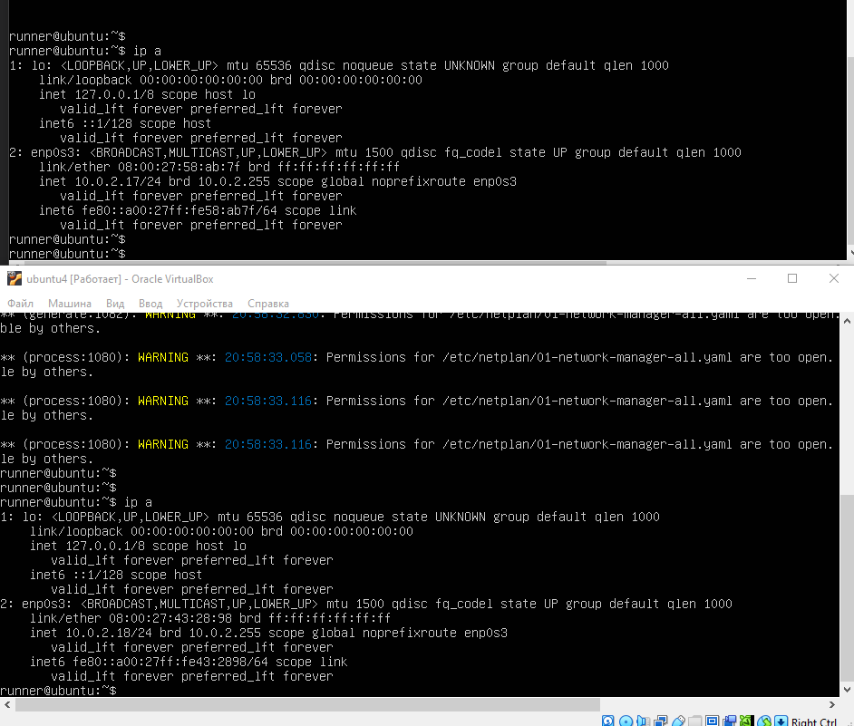
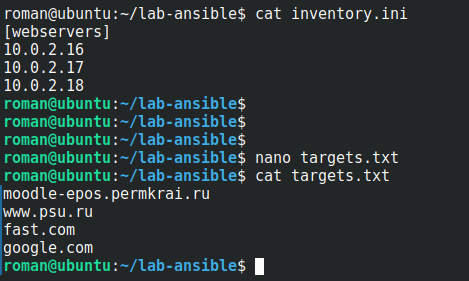
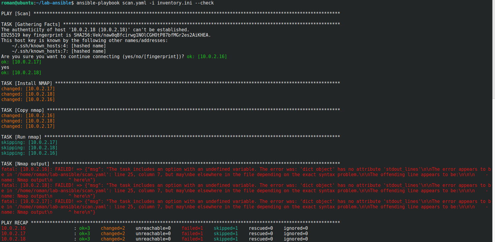

# П05. Работа с переменными в Ansible
Сделать ansible-плейбук, который на целевых хостах:
- устанавливает сканер NMAP
- копирует файл со списком целей для сканирования
- запускает NMAP и сканирует цели
- Собирает результаты сканирования (stdout)
- выводит результаты сканирования


## Выполение задания

### 1. Настройка виртуальных машин
Настроил статические ip адреса на ещё двух машинах теперь 4 машины с адресами
10.0.2.15 - основная машина с которой будет запуск плэйбука
10.0.2.16
10.0.2.17
10.0.2.18



### 2. Редактирование файла inventory.ini и targets.txt



### 3. Тестовый прогон плейбука

*scan.yaml*
```yaml
- name: Scan
  hosts: webservers
  become: yes
  become_method: sudo
  remote_user: runner

  tasks:
    - name: Install NMAP
      ansible.builtin.apt:
        name: nmap
        state: latest
        update_cache: yes

    - name: Copy nmap
      ansible.builtin.copy:
        src: ./targets.txt
        dest: ~/targets.txt
        force: yes
        mode: '0644'

    - name: Run nmap
      ansible.builtin.shell: "nmap -iL ~/targets.txt -p 80 -oG -"
      register: nmap_results

    - name: Nmap output
      ansible.builtin.debug:
        msg: "{{ nmap_results.stdout_lines }}"
```



### 4. Боевой прогон плейбука

Результат:
```
roman@ubuntu:~/lab-ansible$ ansible-playbook scan.yaml -i inventory.ini

PLAY [Scan] **************************************************************************************************************************************************************************

TASK [Gathering Facts] ***************************************************************************************************************************************************************
ok: [10.0.2.17]
ok: [10.0.2.18]
ok: [10.0.2.16]

TASK [Install NMAP] ******************************************************************************************************************************************************************
changed: [10.0.2.16]
changed: [10.0.2.17]
changed: [10.0.2.18]

TASK [Copy nmap] *********************************************************************************************************************************************************************
changed: [10.0.2.16]
changed: [10.0.2.18]
changed: [10.0.2.17]

TASK [Run nmap] **********************************************************************************************************************************************************************
changed: [10.0.2.17]
changed: [10.0.2.18]
changed: [10.0.2.16]

TASK [Nmap output] *******************************************************************************************************************************************************************
ok: [10.0.2.16] => {
    "msg": [
        "# Nmap 7.80 scan initiated Mon Nov 16 21:48:01 2026 as: nmap -iL /root/targets.txt -p 80 -oG -",
        "Host: 212.33.224.16 (212.33.224.16.static-business.perm.ertelecom.ru)\tStatus: Up",
        "Host: 212.33.224.16 (212.33.224.16.static-business.perm.ertelecom.ru)\tPorts: 80/open/tcp//http///",
        "Host: 46.146.231.187 (lemonbro.ru)\tStatus: Up",
        "Host: 46.146.231.187 (lemonbro.ru)\tPorts: 80/open/tcp//http///",
        "Host: 23.52.29.151 (a23-52-29-151.deploy.static.akamaitechnologies.com)\tStatus: Up",
        "Host: 23.52.29.151 (a23-52-29-151.deploy.static.akamaitechnologies.com)\tPorts: 80/open/tcp//http///",
        "Host: 142.250.150.102 (la-in-f102.1e100.net)\tStatus: Up",
        "Host: 142.250.150.102 (la-in-f102.1e100.net)\tPorts: 80/open/tcp//http///",
        "# Nmap done at Mon Nov 16 21:48:01 2026 -- 4 IP addresses (4 hosts up) scanned in 0.20 seconds"
    ]
}
ok: [10.0.2.17] => {
    "msg": [
        "# Nmap 7.80 scan initiated Mon Nov 16 21:47:58 2026 as: nmap -iL /root/targets.txt -p 80 -oG -",
        "Host: 212.33.224.16 (212.33.224.16.static-business.perm.ertelecom.ru)\tStatus: Up",
        "Host: 212.33.224.16 (212.33.224.16.static-business.perm.ertelecom.ru)\tPorts: 80/open/tcp//http///",
        "Host: 46.146.231.187 (lemonbro.ru)\tStatus: Up",
        "Host: 46.146.231.187 (lemonbro.ru)\tPorts: 80/open/tcp//http///",
        "Host: 23.52.29.151 (a23-52-29-151.deploy.static.akamaitechnologies.com)\tStatus: Up",
        "Host: 23.52.29.151 (a23-52-29-151.deploy.static.akamaitechnologies.com)\tPorts: 80/open/tcp//http///",
        "Host: 142.250.150.102 (la-in-f102.1e100.net)\tStatus: Up",
        "Host: 142.250.150.102 (la-in-f102.1e100.net)\tPorts: 80/open/tcp//http///",
        "# Nmap done at Mon Nov 16 21:47:58 2026 -- 4 IP addresses (4 hosts up) scanned in 0.53 seconds"
    ]
}
ok: [10.0.2.18] => {
    "msg": [
        "# Nmap 7.80 scan initiated Mon Nov 16 21:47:58 2026 as: nmap -iL /root/targets.txt -p 80 -oG -",
        "Host: 212.33.224.16 (212.33.224.16.static-business.perm.ertelecom.ru)\tStatus: Up",
        "Host: 212.33.224.16 (212.33.224.16.static-business.perm.ertelecom.ru)\tPorts: 80/open/tcp//http///",
        "Host: 46.146.231.187 (lemonbro.ru)\tStatus: Up",
        "Host: 46.146.231.187 (lemonbro.ru)\tPorts: 80/open/tcp//http///",
        "Host: 23.52.29.151 (a23-52-29-151.deploy.static.akamaitechnologies.com)\tStatus: Up",
        "Host: 23.52.29.151 (a23-52-29-151.deploy.static.akamaitechnologies.com)\tPorts: 80/open/tcp//http///",
        "Host: 142.250.150.102 (la-in-f102.1e100.net)\tStatus: Up",
        "Host: 142.250.150.102 (la-in-f102.1e100.net)\tPorts: 80/open/tcp//http///",
        "# Nmap done at Mon Nov 16 21:47:58 2026 -- 4 IP addresses (4 hosts up) scanned in 0.63 seconds"
    ]
}

PLAY RECAP ***************************************************************************************************************************************************************************
10.0.2.16                  : ok=5    changed=3    unreachable=0    failed=0    skipped=0    rescued=0    ignored=0   
10.0.2.17                  : ok=5    changed=3    unreachable=0    failed=0    skipped=0    rescued=0    ignored=0   
10.0.2.18                  : ok=5    changed=3    unreachable=0    failed=0    skipped=0    rescued=0    ignored=0 
```